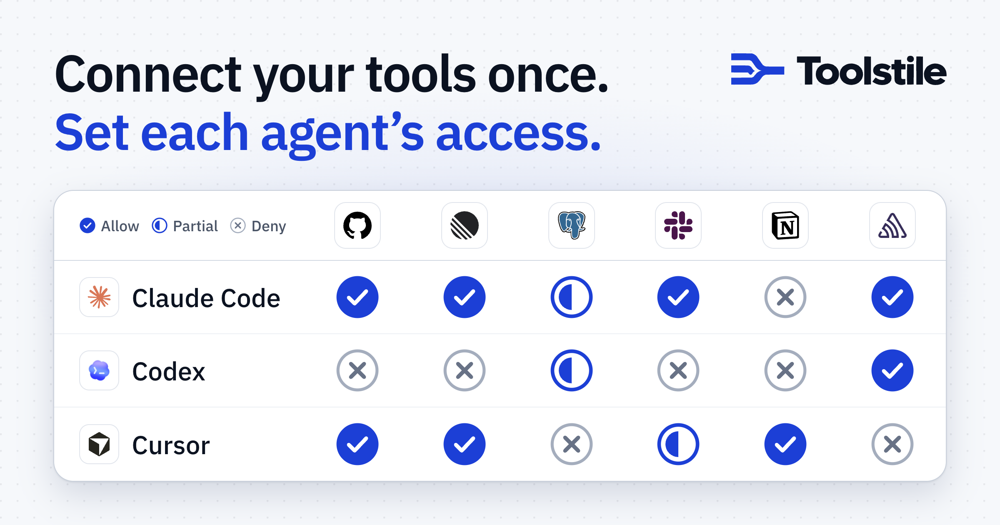

# Toolstile

[](https://www.toolstile.com)
[](https://www.toolstile.com/docs)
[](LICENSE)

Toolstile is an MCP gateway. Connect your remote MCP servers once, then give each AI agent a single endpoint that exposes only the tools, resources and prompts you have granted it. Upstream credentials stay in Toolstile, encrypted at rest; agents hold their own revocable credentials and never see the upstream tokens.



This repository is the source of the self-hosted edition, licensed under Apache-2.0, and the place to report bugs and request features for every edition. A managed version runs at [toolstile.com](https://www.toolstile.com).

## Features

- **One endpoint per agent.** Each agent sees only what it has been granted, aggregated from all of your connections.
- **Connections.** Add a remote MCP server by URL (Streamable HTTP or legacy SSE). Sign in with OAuth (discovery, dynamic or registered clients, PKCE) or set headers. A bundled catalog fills in common servers.
- **Per-agent access.** Grant everything, including tools added later, or individual tools, resources and prompts. Explicit blocks always win, during discovery and during calls. Rules can apply to all of your agents, including future ones.
- **Approvals.** Mark a tool as *Require approval* and each call waits for you to approve or deny it. See [approvals](docs/approvals.md).
- **Tool review.** Turn on review for a connection and new or changed tool definitions are held until you accept them, so that server cannot silently change what your agents can call. See [tool review](docs/tool-review.md).
- **Agents and devices.** Copy the setup command for your agent app and approve the browser consent page. Toolstile creates the agent and a labelled device. Remove a device to revoke every agent on it. Headless scripts can use per-agent tokens with an expiry.
- **Activity.** Call metadata is recorded by default. Payload capture is opt-in, scoped to chosen agents and connections, and time-limited. See [telemetry](docs/telemetry.md).
- **Multi-user instances.** Invitation-only registration, suspension, recovery codes and optional SMTP, GitHub or Google sign-in. Each user's connections, credentials, agents and activity are private to them; administrators manage accounts without seeing that data.

Team workspaces and shared accounts are part of the managed service only.

## Self-host

Requires [Vite+](https://viteplus.dev) (`vp`), which provides Node.js 24 and pnpm 11. Local mode runs on embedded PGlite: no external database, container runtime or account is needed.

```sh
git clone https://github.com/toolstile/toolstile.git
cd toolstile
vp install --frozen-lockfile
vp run build
node scripts/local.mjs init
node scripts/local.mjs bootstrap you@example.com
node scripts/local.mjs start
```

`bootstrap` prints a private invitation link. Open it and register. Then stop the server with Ctrl-C, make yourself an administrator and start it again:

```sh
node scripts/local.mjs operator you@example.com
node scripts/local.mjs start
```

The dashboard runs at `http://127.0.0.1:4310`. Data and keys are stored in `~/.local/share/toolstile`. See [local operation](docs/local-operation.md) for HTTPS, LAN access, upgrades and backups.

To run on a server:

- [Docker Compose](docs/containers.md): one host with PostgreSQL 17 behind your HTTPS reverse proxy.
- [Kubernetes](docs/kubernetes.md): the same image with your own PostgreSQL, Secrets and ingress.

Both build the image from source, run a single application replica as a non-root user and read secrets from files. Keep the authentication and encryption keys stable across upgrades. [Installation](docs/installation.md) compares the options.

## Use the managed service

[Create a free account](https://app.toolstile.com/auth/sign-up) and connect a remote MCP server under **MCP connections**. Your gateway address is `https://mcp.toolstile.com/mcp`. The [documentation](https://www.toolstile.com/docs) covers plans, teams and each client in detail.

## Connect an agent

Add a connection in the dashboard, then open **Agents** and copy the command for your client. Replace the address with your own instance's `/mcp` URL when self-hosting.

**Claude Code:** add the server, then start Claude Code, run `/mcp`, choose `toolstile` and sign in.

```sh
claude mcp add --transport http toolstile 'https://mcp.toolstile.com/mcp'
```

**Codex:**

```sh
codex mcp add toolstile --url 'https://mcp.toolstile.com/mcp'
codex mcp login toolstile
```

Signing in opens a consent page in your browser. Approve it and the agent appears in the dashboard, where you choose what it can use. A new agent gets only the rules you set for all agents; everything else needs a grant. Cursor and other clients that support remote MCP with OAuth work the same way. Claude Desktop connects from Anthropic's servers, so it needs an instance reachable from the internet, not the local `127.0.0.1` address.

## How it works

Toolstile is a TypeScript monorepo: a TanStack Start application with oRPC, Better Auth, Drizzle and the official MCP SDK. One PostgreSQL schema runs on a PostgreSQL server or on embedded PGlite.

| Path | Contents |
| --- | --- |
| `apps/web` | Application, server runtime, migrations and admin scripts |
| `packages/gateway` | MCP gateway runtime: grants, approvals, tool review, upstream OAuth and the outbound destination policy |
| `packages/auth` | Better Auth setup, the agent OAuth provider and credential encryption |
| `packages/api` | oRPC management API and the connector catalog |
| `packages/database` | Drizzle schema, PostgreSQL and PGlite adapters, transactions |
| `packages/ui` | React dashboard components and StyleX styles |
| `tests` | Integration and MCP/OAuth protocol suites |

Read [architecture](docs/architecture.md) and [packages](docs/packages.md) for the boundaries, and [product scope](docs/product.md) for the permission model.

## Limitations

- Remote MCP servers only. Toolstile does not run local stdio servers.
- One application replica. MCP sessions reconnect after a restart; there is no horizontal session forwarding.
- Self-hosting builds from source. There is no prebuilt package or published image yet.
- Local mode is verified on macOS arm64. The container image is Linux; other local platforms are untested.

## Related projects

- [`toolstile` CLI](https://github.com/toolstile/cli): `npx toolstile audit` checks the MCP configs on your machine for plaintext secrets and risky settings, and `npx toolstile mcp setup` connects your local agents to Toolstile.
- [Toolstile plugins](https://github.com/toolstile/plugins): install Toolstile as a plugin in Claude Code or Cursor.

## Issues and contributing

[Open an issue](https://github.com/toolstile/toolstile/issues/new/choose) for bugs, feature requests and MCP server or client compatibility, whether you self-host or use the managed service. Issues are public: never include tokens, API keys, account emails or request data. Account and billing questions go to [support@toolstile.com](mailto:support@toolstile.com).

Report vulnerabilities privately as described in [SECURITY.md](SECURITY.md). [CONTRIBUTING.md](CONTRIBUTING.md) covers setup, checks and DCO sign-off, and the [documentation index](docs/README.md) lists everything else.

## License

[Apache-2.0](LICENSE). Third-party notices are in [NOTICE](NOTICE). The managed service is provided under its [terms](https://www.toolstile.com/terms).
